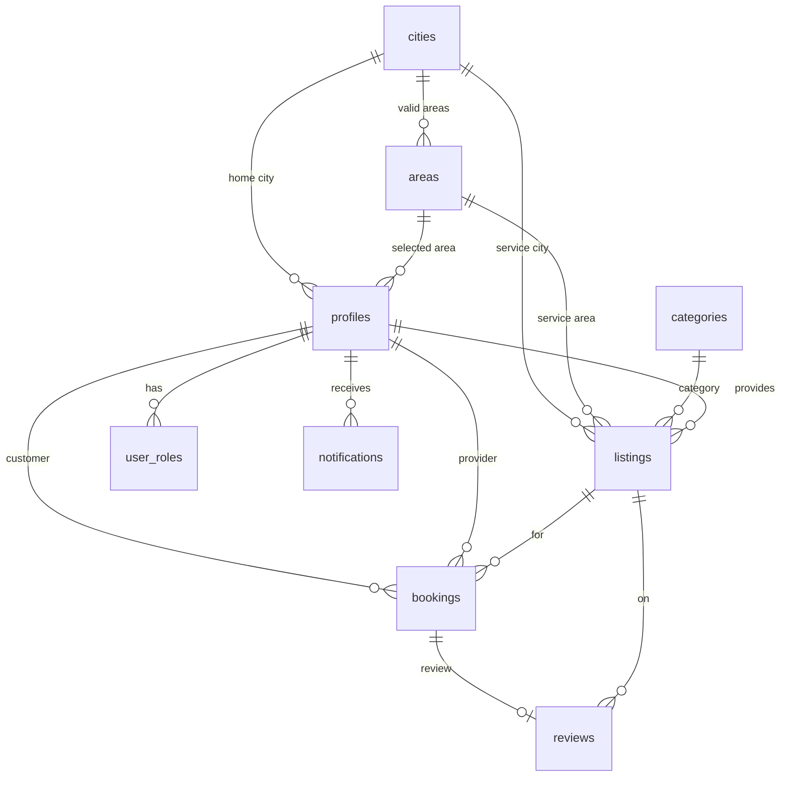

# Database Design

**Product:** LocalServe  
**Status:** Draft for MVP  
**Based on:** [PRD.md](./PRD.md), [architecture.md](./architecture.md)  
**Engine:** PostgreSQL (Supabase)

This is the source of truth for tables, constraints, indexes, RLS intent, and RPC contracts. Migrations in `supabase/migrations` must not drift from this file.

## Repository migration status

`supabase/migrations/20260926000000_baseline.sql` is the clean-project baseline. It defines the base schema, signup and timestamp triggers, helper functions, RLS policies, grants, public-profile projection, and Samundri reference catalog. The later timestamped migrations remain the incremental changes layered on that baseline; their RPC and Storage definitions are intentionally not copied into the baseline.

This baseline is reconstructed from this document and the checked-in generated database types because the earlier source DDL was not present in the repository. It has not been executed against a fresh database. A partial hosted catalog inspection was completed on 2026-09-28; treat the SQL here and in the baseline as intended state, not proof that every hosted object matches it.

For a new Supabase project, apply migrations in timestamp order with `supabase db push --linked` after linking that new project and supplying its database password securely through the CLI prompt. Do not put the password in Vite variables or commit it.

For an existing populated project, do **not** run the baseline as pending SQL. First compare the hosted schema, policies, grants, functions, triggers, views, Storage policies, and reference data against this baseline and the later migrations. Only after a complete comparison confirms the baseline is already represented may an operator use `supabase migration repair --status applied 20260926000000 --linked` to record it without executing it. The hosted migration-history table currently lists only the nine later migrations (`20260926180000` through `20260928150000`); it does not list baseline `20260926000000`. The catalog check found all nine documented application tables with RLS enabled, but also found hosted differences described below. Full baseline parity and migration repair remain unverified; no hosted changes were made.

## 1. Conventions

| Topic                                        | Choice                                                                             |
| -------------------------------------------- | ---------------------------------------------------------------------------------- |
| Primary keys                                 | `uuid`, default `gen_random_uuid()`                                                |
| Profile identity                             | `profiles.id` = `auth.users.id` (1:1, no separate user table)                      |
| Time                                         | `timestamptz`, store UTC, display in the client                                    |
| Money                                        | `numeric(12,2)` + `char(3)` ISO currency (default `PKR`)                           |
| Soft hide                                    | `is_active` / `is_hidden` — do not hard-delete bookings or reviews                 |
| Strings                                      | `text`; slugs unique                                                               |
| Updates                                      | `created_at` / `updated_at`; `updated_at` via trigger                              |
| Writes that change booking status or reviews | **RPC only** (`security definer` with explicit checks), not direct client `UPDATE` |

Auth email and password live in `auth.users`. Do not duplicate email on `profiles`.

## 2. ER overview

```text
auth.users 1─────────── 1 profiles
                              │
                              ├── 1──N user_roles
                              ├── 1──N listings          (as provider)
                              ├── 1──N bookings          (as customer)
                              ├── 1──N bookings          (as provider)
                              ├── 1──N reviews           (as author)
                              └── 1──N notifications

cities 1───N areas
cities 1───N profiles
cities 1───N listings
areas 1───N profiles
areas 1───N listings
categories 1───N listings

listings 1───N bookings
listings 1───N reviews

bookings 1───0..1 reviews     (one customer review per booking)
```



## 3. Enums

```sql
create type public.user_role as enum ('customer', 'provider', 'admin');

create type public.pricing_type as enum ('hourly', 'fixed');

create type public.booking_status as enum (
  'requested',
  'accepted',
  'declined',
  'in_progress',
  'completed',
  'cancelled_by_customer',
  'cancelled_by_provider'
);

create type public.notification_type as enum (
  'booking_requested',
  'booking_accepted',
  'booking_declined',
  'booking_cancelled',
  'booking_completed'
);
```

Do not add `pending` or `paid` until payments exist.

## 4. Tables

### 4.1 `cities`

Catalog of metros. Launch with one active city: **Samundri**, the city and headquarters of Samundri Tehsil in Faisalabad District. The schema is designed for multi-city growth, but the MVP location is fixed to Samundri and the user selects an approved locality within it.

| Column     | Type                               | Rules                                      |
| ---------- | ---------------------------------- | ------------------------------------------ |
| id         | uuid PK                            |                                            |
| name       | text not null                      | `Samundri`                                 |
| slug       | text not null unique               | `samundri`                                 |
| is_active  | boolean not null default true      | inactive cities hidden from pickers/search |
| created_at | timestamptz not null default now() |                                            |
| updated_at | timestamptz not null default now() |                                            |

### 4.1a `areas`

Fixed list of approved localities inside Samundri city. The initial seed uses four provisional, in-city areas so database work can proceed; refine the list later without changing the schema. Do not add distant towns or unlisted free-text locations.

| Column     | Type                               | Rules                                   |
| ---------- | ---------------------------------- | --------------------------------------- |
| id         | uuid PK                            |                                         |
| city_id    | uuid not null FK → cities(id)      | always the Samundri city in MVP         |
| name       | text not null                      | one of the approved Samundri localities |
| slug       | text not null unique               | area slug                               |
| is_active  | boolean not null default true      | hidden when no longer valid             |
| created_at | timestamptz not null default now() |                                         |
| updated_at | timestamptz not null default now() |                                         |

Reference seed: Anarkali Bazaar (`anarkali-bazaar`), Babar Town (`babar-town`), Canal Town (`canal-town`), and Jinnah Market (`jinnah-market`). These are the active localities observed in the public catalog on 2026-09-28.

### 4.2 `categories`

Flat list in MVP (`parent_id` reserved, always null for now).

| Column                  | Type                          | Rules     |
| ----------------------- | ----------------------------- | --------- |
| id                      | uuid PK                       |           |
| name                    | text not null                 |           |
| slug                    | text not null unique          |           |
| parent_id               | uuid null FK → categories(id) | MVP: null |
| sort_order              | int not null default 0        |           |
| is_active               | boolean not null default true |           |
| created_at / updated_at | timestamptz                   |           |

Reference seed: Electrician (`electrician`), Plumbing (`plumbing`), AC Repair (`ac`), Cleaning (`cleaning`), Carpentry (`carpentry`), Tutoring (`tutoring`), and Home Repair (`home-repair`). The names/slugs match the active public catalog observed during the 2026-09-28 audit.

### 4.3 `profiles`

Public-ish person record, keyed by Auth.

| Column                  | Type                                          | Rules                                          |
| ----------------------- | --------------------------------------------- | ---------------------------------------------- |
| id                      | uuid PK FK → auth.users(id) on delete cascade |                                                |
| display_name            | text not null                                 |                                                |
| phone                   | text null                                     | not on public listing cards                    |
| city_id                 | uuid not null FK → cities(id)                 | home city, fixed to Samundri in MVP            |
| area_id                 | uuid not null FK → areas(id)                  | selected locality from the fixed Samundri list |
| bio                     | text null                                     | provider-facing                                |
| is_verified             | boolean not null default false                | **admin-only** flag (PRD open decision)        |
| is_active               | boolean not null default true                 | admin deactivate = ban                         |
| created_at / updated_at | timestamptz                                   |                                                |

Created by trigger on `auth.users` insert. Signup must not be able to set `is_verified`, `is_active`, or the city/area outside the fixed Samundri choices.

`handle_new_user` accepts only `customer` or `provider` metadata roles. Missing, invalid, inactive, or out-of-city `area_id` metadata falls back to the first active Samundri area ordered by name and id. If no active Samundri city or area exists, signup fails closed.

### 4.4 `user_roles`

Dual role without a second account.

| Column     | Type                                              | Rules |
| ---------- | ------------------------------------------------- | ----- |
| user_id    | uuid not null FK → profiles(id) on delete cascade |       |
| role       | user_role not null                                |       |
| created_at | timestamptz not null default now()                |       |
| **PK**     | `(user_id, role)`                                 |       |

**Rules**

- Public signup inserts exactly one of `customer` or `provider`.
- User may later add the other marketplace role through `add_marketplace_role`.
- `admin` is **never** insertable by the client. Seed in SQL / dashboard.

### 4.5 `listings`

A provider offering in one city, one valid area, and one category.

| Column                  | Type                              | Rules                                                     |
| ----------------------- | --------------------------------- | --------------------------------------------------------- |
| id                      | uuid PK                           |                                                           |
| provider_id             | uuid not null FK → profiles(id)   |                                                           |
| city_id                 | uuid not null FK → cities(id)     | fixed to Samundri in MVP                                  |
| area_id                 | uuid not null FK → areas(id)      | selected Samundri locality                                |
| category_id             | uuid not null FK → categories(id) |                                                           |
| title                   | text not null                     |                                                           |
| description             | text not null                     |                                                           |
| pricing_type            | pricing_type not null             |                                                           |
| price_amount            | numeric(12,2) not null            | `check (price_amount > 0)`                                |
| currency                | char(3) not null default 'PKR'    |                                                           |
| duration_minutes        | int null                          | `check (duration_minutes > 0)`                            |
| cover_image_path        | text null                         | Storage path, not a free-form remote HTML                 |
| availability_note       | text null                         | unstructured (no calendar table)                          |
| is_active               | boolean not null default true     | search only if true **and** city/category/provider active |
| rating_avg              | numeric(3,2) not null default 0   | denormalized from visible reviews                         |
| rating_count            | int not null default 0            | `check (rating_count >= 0)`                               |
| created_at / updated_at | timestamptz                       |                                                           |

Create/update allowed only if the actor has `provider` role and `provider_id = auth.uid()`.

Deactivating a listing does **not** cascade-cancel bookings.

### 4.6 `bookings`

One customer, one provider, one listing. Price/title **snapshotted**.

| Column                  | Type                            | Rules                                 |
| ----------------------- | ------------------------------- | ------------------------------------- |
| id                      | uuid PK                         |                                       |
| listing_id              | uuid not null FK → listings(id) |                                       |
| customer_id             | uuid not null FK → profiles(id) |                                       |
| provider_id             | uuid not null FK → profiles(id) | denormalized for inbox queries        |
| status                  | booking_status not null         | default `requested` on insert via RPC |
| scheduled_start         | timestamptz not null            |                                       |
| scheduled_end           | timestamptz null                |                                       |
| address_text            | text not null                   | PII; parties + admin only             |
| notes                   | text null                       |                                       |
| snapshot_title          | text not null                   | copied from listing at create         |
| snapshot_pricing_type   | pricing_type not null           |                                       |
| snapshot_price_amount   | numeric(12,2) not null          |                                       |
| snapshot_currency       | char(3) not null                |                                       |
| decline_reason          | text null                       |                                       |
| cancel_reason           | text null                       |                                       |
| completed_at            | timestamptz null                | set on complete                       |
| created_at / updated_at | timestamptz                     |                                       |

**Checks**

- `customer_id <> provider_id`
- `scheduled_end is null or scheduled_end > scheduled_start`
- `provider_id` must equal `listings.provider_id` at create (enforced in RPC)

**No unique** on `(listing_id, scheduled_start)` — double-booking is allowed in MVP.

Client **must not** `insert`/`update` this table directly. All changes go through RPCs in §8.

### 4.7 `reviews`

Customer review of the listing/provider after completion.

| Column             | Type                                   | Rules                                    |
| ------------------ | -------------------------------------- | ---------------------------------------- |
| id                 | uuid PK                                |                                          |
| booking_id         | uuid not null unique FK → bookings(id) | one review per booking                   |
| listing_id         | uuid not null FK → listings(id)        |                                          |
| author_id          | uuid not null FK → profiles(id)        | must be booking.customer_id              |
| target_provider_id | uuid not null FK → profiles(id)        | must be booking.provider_id              |
| rating             | smallint not null                      | `check (rating between 1 and 5)`         |
| comment            | text null                              | if present, `char_length(comment) >= 10` |
| is_hidden          | boolean not null default false         | admin moderate                           |
| created_at         | timestamptz not null default now()     |                                          |

No `updated_at` in MVP (reviews are insert-once). Hide is an admin RPC, not an author edit.

### 4.8 `notifications`

In-app inbox. Email is later.

| Column     | Type                                              | Rules              |
| ---------- | ------------------------------------------------- | ------------------ |
| id         | uuid PK                                           |                    |
| user_id    | uuid not null FK → profiles(id) on delete cascade | recipient          |
| type       | notification_type not null                        |                    |
| booking_id | uuid null FK → bookings(id)                       |                    |
| payload    | jsonb not null default '{}'                       | short message, ids |
| read_at    | timestamptz null                                  |                    |
| created_at | timestamptz not null default now()                |                    |

Insert only from booking/review RPCs (`security definer`). Recipient may `update` `read_at` on own rows.

## 5. Booking state machine (data rules)

Allowed transitions (anything else raises):

| From          | Event              | To                                                | Actor                                 |
| ------------- | ------------------ | ------------------------------------------------- | ------------------------------------- |
| —             | `create_booking`   | `requested`                                       | customer (not listing owner)          |
| `requested`   | `accept_booking`   | `accepted`                                        | listing provider                      |
| `requested`   | `decline_booking`  | `declined`                                        | listing provider                      |
| `requested`   | `cancel_booking`   | `cancelled_by_customer`                           | customer                              |
| `accepted`    | `start_booking`    | `in_progress`                                     | provider (planned; no current RPC/UI) |
| `accepted`    | `complete_booking` | `completed`                                       | provider                              |
| `in_progress` | `complete_booking` | `completed`                                       | provider                              |
| `accepted`    | `cancel_booking`   | `cancelled_by_customer` / `cancelled_by_provider` | matching party                        |
| `in_progress` | `cancel_booking`   | `cancelled_by_*`                                  | matching party                        |

Terminal: `declined`, `completed`, `cancelled_by_customer`, `cancelled_by_provider`.

Reason required when declining, and when cancelling from `accepted` or `in_progress`.

## 6. Indexes

```text
cities (slug)
areas (city_id, slug)
categories (slug)
profiles (city_id, area_id)
user_roles (role)                          -- admin lookups
listings (city_id, area_id, is_active, category_id)
listings (provider_id)
listings (is_active, rating_avg desc)      -- sort by rating
listings (is_active, price_amount)         -- sort by price
bookings (provider_id, status, created_at desc)
bookings (customer_id, created_at desc)
bookings (listing_id)
reviews (listing_id, created_at desc) where not is_hidden
notifications (user_id, created_at desc)
notifications (user_id) where read_at is null
```

Full-text (`tsvector` on listing title + description) only if `ilike` p95 becomes a problem.

## 7. RLS intent

Enable RLS on every public table. Helper functions (stable, security definer, `search_path` pinned):

- `is_admin()` → `exists user_roles where user_id = auth.uid() and role = 'admin'`
- `has_role(r)` → same for `r`
- `is_booking_party(booking_id)` → customer or provider is `auth.uid()`
- `is_public_listing(listing_id)` → listing and related active city, area, category, and provider are all active

| Table                     | SELECT                                                                                                                | INSERT                                                             | UPDATE                                       | DELETE            |
| ------------------------- | --------------------------------------------------------------------------------------------------------------------- | ------------------------------------------------------------------ | -------------------------------------------- | ----------------- |
| cities, areas, categories | active rows: anon + auth; all rows: admin                                                                             | admin RPC only                                                     | admin RPC only                               | none (deactivate) |
| profiles                  | own row always; public fields through `profiles_public`; direct rows only for self/admin/eligible booking counterpart | trigger only (from auth)                                           | `update_account_profile` / future admin RPC  | none              |
| user_roles                | own rows; admin all                                                                                                   | signup trigger / `add_marketplace_role`; never `admin` from client | none                                         | none              |
| listings                  | `is_active` (and city/area/category/provider active) for anon+auth; owner sees inactive; admin all                    | owner + `has_role('provider')`                                     | owner (not rating\_\*); admin via future RPC | none              |
| bookings                  | party or admin **only** (no public)                                                                                   | **denied** (RPC)                                                   | **denied** (RPC) except none from client     | none              |
| reviews                   | `not is_hidden` public; admin all; author sees own even if hidden                                                     | **denied** (RPC)                                                   | **denied**; admin hide via future RPC        | none              |
| notifications             | own                                                                                                                   | **denied** (RPC)                                                   | own `read_at`                                | none              |

**Phone (PRD default: after accept):** a SELECT policy on `profiles` may include `phone` only when the viewer is self, admin, or `is_booking_party` on a booking with that provider/customer in status `accepted`, `in_progress`, or `completed`. Guests never see phone.

**Address:** only on `bookings`, which strangers cannot select. Do not join address onto listing views.

The `profiles_public` view is an explicit public-column projection (`id`, `display_name`, `bio`, `city_id`, `is_verified`) over active profiles. The baseline uses a security-barrier, owner-executed view because authenticated users need `phone` access on the base table for own/eligible booking-party reads; an invoker view combined with a public-profile row policy and a role-wide `phone` grant could expose phone values for every publicly visible row. Direct reads of `profiles` remain protected by RLS and restricted to the caller, an admin, or an eligible booking counterpart.

**Hosted comparison (2026-09-28):** the deployed view has options `security_barrier=true, security_invoker=true`, not the baseline's owner-executed (`security_invoker=false`) setting. The deployed `profiles` SELECT policy is only `profiles_select_self_or_admin`; there is no public-profile or booking-counterpart policy. This means the hosted invoker view cannot return another user's profile row under RLS, and the booking detail page's direct provider-phone lookup also lacks a matching party policy. Do not change the intended design based on this observation; reconcile and test the hosted behavior before making a migration.

**Rating columns:** client must not update `rating_avg` / `rating_count`; grant update only to the recompute function.

## 8. RPC contracts

All `security definer`, validate `auth.uid()`, set `search_path = public`. Return the affected booking or review row.

| Function                       | Arguments                                                       | Behavior                                                                                                                               |
| ------------------------------ | --------------------------------------------------------------- | -------------------------------------------------------------------------------------------------------------------------------------- |
| `create_booking`               | listing_id, scheduled_start, scheduled_end, address_text, notes | Caller has `customer` (or is dual-role). Listing active. Caller ≠ provider. Snapshot price/title. status `requested`. Notify provider. |
| `accept_booking`               | booking_id                                                      | Caller = provider, status `requested` → `accepted`. Notify customer.                                                                   |
| `decline_booking`              | booking_id, reason                                              | Caller = provider, `requested` → `declined`. Notify customer.                                                                          |
| `cancel_booking`               | booking_id, reason                                              | Per §5. Notify the other party.                                                                                                        |
| `complete_booking`             | booking_id                                                      | Provider, `accepted` or `in_progress` → `completed`, set `completed_at`. Notify customer.                                              |
| `submit_review`                | booking_id, rating, comment                                     | Caller = customer, status `completed`, no existing review. Insert review. Recompute listing aggregates (visible reviews only).         |
| `get_booking_customer_names`   | booking_ids                                                     | Return customer display names only for bookings where the caller is a customer or provider party; never return phone.                  |
| `get_public_provider_profiles` | provider_ids, city_id, area_id, name_query                      | Publicly return only `id`, `display_name`, `bio`, and `is_verified` for active profiles with an active listing in active catalog rows. |
| `add_marketplace_role`         | role `customer` \| `provider`                                   | Adds the missing side role. Reject `admin`.                                                                                            |
| `update_account_profile`       | display_name, phone, area_id, bio                               | Updates the caller’s own editable profile fields; area must be active and belong to the active Samundri city.                          |
| `admin_set_listing_active`     | listing_id, is_active                                           | Admin; toggle listing visibility.                                                                                                      |
| `admin_set_profile_active`     | profile_id, is_active                                           | Admin; toggle marketplace profile activity.                                                                                            |
| `admin_set_review_visible`     | review_id, is_visible                                           | Admin; toggle review visibility and recompute listing aggregates in the same transaction.                                              |
| `admin_set_profile_verified`   | profile_id, is_verified                                         | Admin; toggle provider verification.                                                                                                   |
| `mark_notifications_read`      | optional id                                                     | Own rows.                                                                                                                              |

`start_booking` is described as an optional event in the state-machine design but is not implemented in the current migrations or generated function types. The `in_progress` status remains in the enum and can be handled by completion/cancellation logic, but there is no current RPC or UI action that starts it.

The four listing/profile/review admin functions above are implemented in `20260930100000_admin_write_rpcs.sql`. They authorize with `is_admin()` inside each function, pin `search_path = public`, and are executable only by `authenticated`. Their migration is not yet deployed or behavior-tested. City/category mutations and `admin_get_booking_by_id` remain unimplemented. City changes must preserve the MVP's active Samundri launch-city and approved-area invariants; booking lookup should return only the minimum support fields and must not expose `auth.users` data.

Illegal transition → `raise exception` with a stable code (e.g. `BOOKING_INVALID_TRANSITION`) so the client can map it.

### Rating recompute

After review insert or hide/unhide:

```text
rating_count = count(*) from reviews
  where listing_id = ? and is_hidden = false
rating_avg   = coalesce(avg(rating), 0)
```

Same transaction as the review write.

Public provider pages use `get_public_provider_profiles` to fetch only the documented public fields and are available only while the provider has an active public listing. Their service and locality data comes from active public `listings`, `categories`, and `areas`. Reviews are queried by `target_provider_id` with `is_hidden = false`; public review RLS remains authoritative. Reviewer names, when available, come from `profiles_public`. No profile-photo column is currently defined.

## 9. Triggers

| Trigger                                              | Purpose                                                                                                                      |
| ---------------------------------------------------- | ---------------------------------------------------------------------------------------------------------------------------- |
| `auth.users` after insert                            | Insert `profiles` (display_name from metadata) + `user_roles` from metadata `role` ∈ customer\|provider. Ignore/strip admin. |
| `set_updated_at`                                     | Before update on tables with `updated_at`.                                                                                   |
| Optional: block direct `bookings` / `reviews` writes | Defense in depth if grants are wrong; RPCs remain the API.                                                                   |

## 10. Storage (not a SQL table)

Bucket: `listing-covers`

- Object key: `{provider_id}/{listing_id}/{filename}`
- Store `cover_image_path` on `listings`
- Policies: authenticated insert/update under own `provider_id` prefix; public read
- MIME: jpeg, png, webp; max ~2 MB; no SVG

## 11. Seed (minimum)

| Entity        | Example                                                                                 |
| ------------- | --------------------------------------------------------------------------------------- |
| City          | Samundri (`samundri`, active)                                                           |
| Areas         | provisional in-city localities (Anarkali Bazaar, Jinnah Market, Babar Town, Canal Town) |
| Categories    | tutoring, electrician, cleaning, home-repair, plumbing                                  |
| Admin         | created in Auth, `user_roles.admin`, `is_verified true`                                 |
| Demo provider | 2 active listings in Samundri, each assigned an approved locality                       |
| Demo customer | no listings                                                                             |

Never seed real PII. Admin password is rotated before production.

## 12. Grants (summary)

- `anon`: SELECT on active cities, categories, active listings, visible reviews (via RLS).
- `authenticated`: plus own profile/listings/bookings/notifications as RLS allows; EXECUTE on RPCs in §8 (admin RPCs fail inside if not admin).
- `service_role`: bypass RLS (dashboard, never in the Vite app).

Revoke `insert/update/delete` on `bookings` and `reviews` from `anon` and `authenticated`.

**Hosted grants checked 2026-09-28:** direct `INSERT`/`UPDATE`/`DELETE` privileges on `bookings` and `reviews` are absent for `anon` and `authenticated`. However, both roles have table-level `INSERT`/`UPDATE`/`DELETE` privileges on `listings` and `user_roles`; current RLS permits listing writes only through its provider-owner policies and has no `user_roles` write policy. `anon` also has `SELECT` on `bookings` and the `address_text` column, while the deployed booking SELECT policy is authenticated-only and party/admin scoped. These grants are protected by RLS in the current catalog but exceed the documented least-privilege intent and should be reviewed; no grant was changed during verification.

## 13. Explicitly not modeled (MVP)

| Omitted                        | Why                                   |
| ------------------------------ | ------------------------------------- |
| Payments, invoices, escrow     | PRD non-goal                          |
| Chat messages                  | PRD non-goal                          |
| Availability slots / calendars | unstructured `availability_note` only |
| Geo coordinates / radius       | city FK only                          |
| Recurring bookings             | one-off rows                          |
| Provider staff / org accounts  | one profile = one provider            |
| Reports tables                 | query bookings later                  |

## 14. Integrity checklist

- [ ] `customer_id <> provider_id` on bookings
- [ ] Review unique on `booking_id`
- [ ] Review author is the booking customer
- [ ] Snapshot columns filled at create, never edited by listing PATCH
- [ ] `admin` role not grantable from signup
- [ ] Inactive listing excluded from public search
- [ ] Hidden reviews excluded from `rating_avg`
- [ ] Address and phone not selectable by guests
